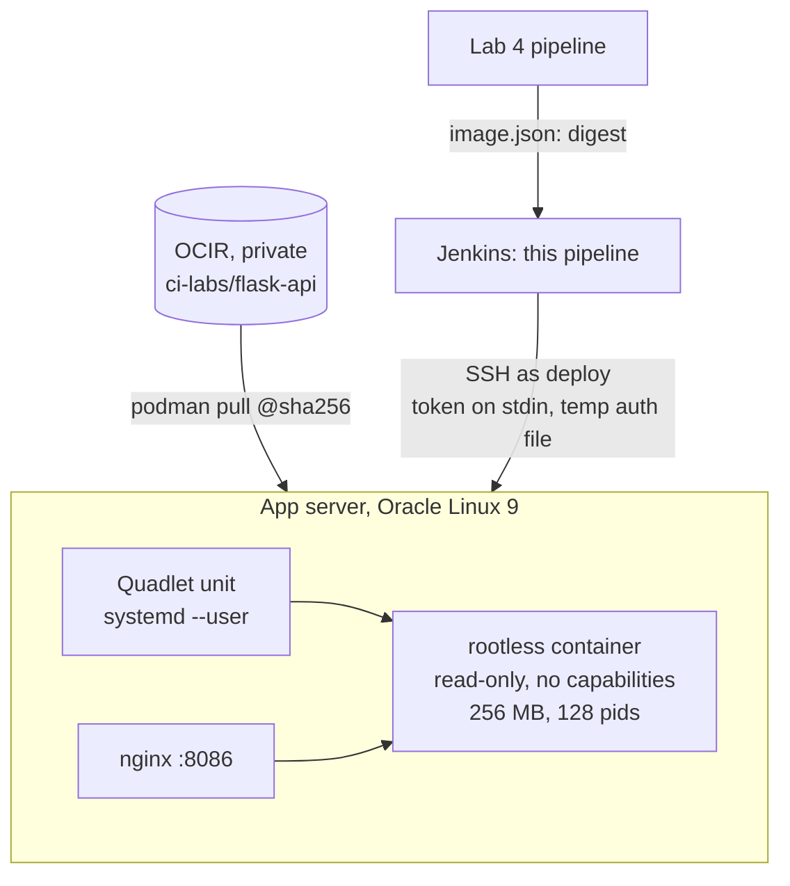
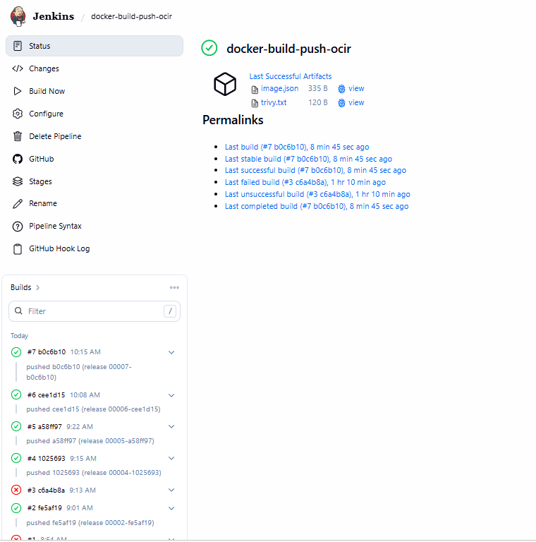
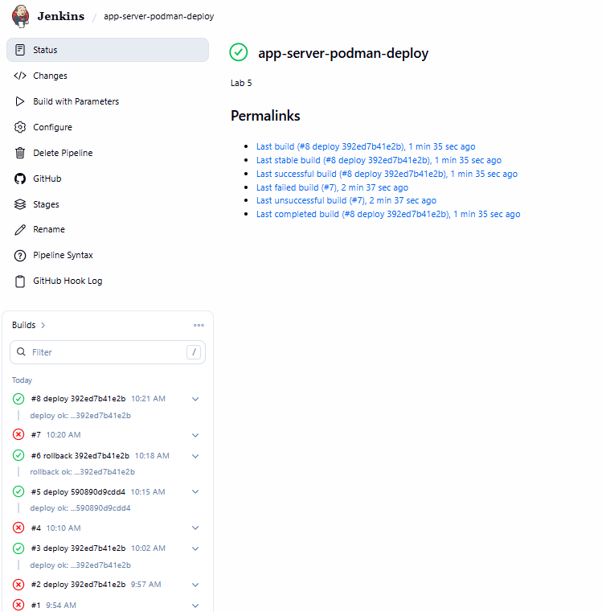

# app-server-podman-deploy

Pull-based container deployment on Oracle Cloud Infrastructure. Jenkins deploys an image that
[Lab 4](https://github.com/abdulzaferdevops/docker-build-push-ocir) built, scanned and pushed to
OCI Container Registry, **by digest**, to an Oracle Linux 9 app server. There it runs as a
**rootless Podman container** managed by a **Quadlet systemd user service**, is health-checked
through nginx, and is rolled back automatically if the new release is unhealthy.

Lab 5 of a series of CI/CD labs on OCI (GitHub · Jenkins · Docker · Oracle Linux).

## Architecture



## What changed from Labs 2–3

| | Labs 2–3 (files) | Lab 5 (images) |
|:--|:--|:--|
| What is deployed | Files copied over SSH, built on the server | An **immutable image digest** built once by Lab 4 |
| Runtime | Process under a system service | **Rootless** container under a **user** service |
| Privileges for deploy | A narrow sudo rule to restart the service | **No sudo at all**: `deploy` owns its user service |
| Isolation | Linux user + systemd hardening | User namespace, read-only root, all capabilities dropped, memory and pid limits |
| Release identity | `RELEASE` file written by the pipeline | Read from the image's own `org.opencontainers.image.version` label |

## Pipeline

| Stage | What it does |
|:--|:--|
| Preflight | Checks settings and the SSH connection; shows the server's Podman version |
| Resolve image | `deploy`: the given digest (or the live one, to redeploy). `rollback`: the newest **healthy** release older than the live one. Only `…/ci-labs/flask-api@sha256:<64 hex>` from this registry is accepted |
| Pull on server | Registry token sent on stdin into an owner-only temporary auth file, deleted after the pull |
| Deploy | Renders the Quadlet unit for the digest, restarts the user service, checks `/health` reports the image's release; restores the previous image if not |
| Smoke test | Calls the API through nginx and shows the running container |

## Container hardening (Quadlet)

```ini
[Container]
Image=<registry>/<namespace>/ci-labs/flask-api@sha256:<digest>
Pull=never                      # only the image Jenkins pulled and verified
PublishPort=127.0.0.1:5004:8000 # localhost only; nginx is the entry point
ReadOnly=true
Tmpfs=/tmp
DropCapability=ALL
NoNewPrivileges=true
PodmanArgs=--memory=256m --pids-limit=128
```

## Server preparation

Podman from Oracle Linux 9 AppStream; lingering for the `deploy` user so its services run at boot;
cgroup v2 delegation so rootless containers can have memory and pid limits; the Quadlet unit
validated with `quadlet -dryrun` before first use; nginx on port 8086 with SELinux and firewalld rules.

## Results



| Build | Trigger | Outcome |
|:--|:--|:--|
| #3 | Manual, Lab 4 digest | First deploy: `none → 00004`, rootless container healthy |
| #4 | Manual, `docker.io/library/nginx@sha256:…` | **Refused**: only this registry's `ci-labs/flask-api@sha256:` is accepted |
| #5 | **Lab 4 build #7** (one `git push`) | Built, tested, scanned, pushed and deployed `00007`; Lab 4 waited for the verdict |
| #6 | Manual, `ACTION=rollback` | Server picked the previous healthy release, re-pulled it by digest: `00007 → 00004` |

Verified on the running container: UID 10001 inside, an unprivileged UID 175536 on the host,
read-only root filesystem, all capabilities dropped, 256 MB memory and 128-process limits (about 57 MB in use).



## Licence

MIT
